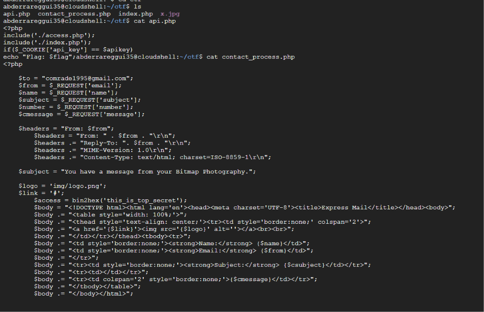
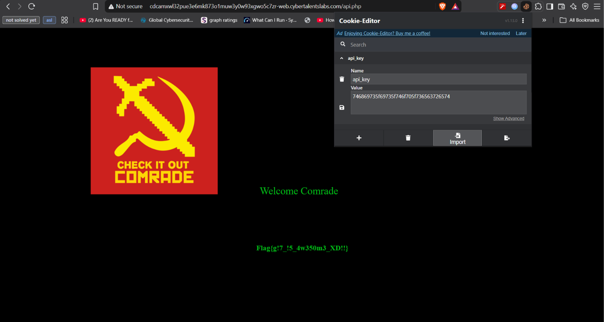

COMRADE III
We get in, nothing intresting we use dirb we find /.git directory we dump it using git-dumper 
we get acces.php and contact.php 
 
we get the flag when we get into /api.php when our api_key wich is stored into the cookies wich is "this_is_top_secret" in hex
 

we do that and we get the flag 
