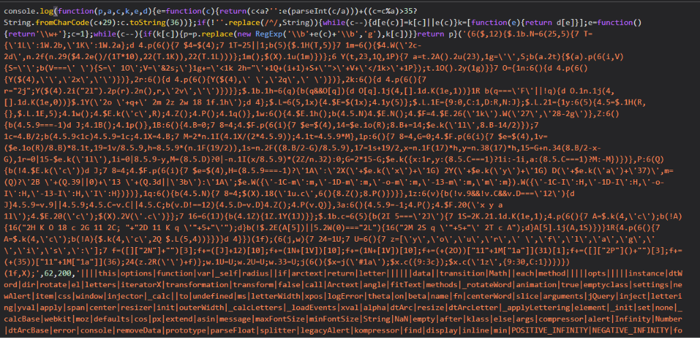
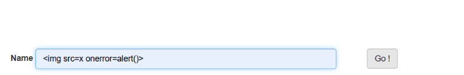

COOL NAME
We visit the page we find a script that make a cool effect on your name 
This might lead into a XSS attack we try using ""
and we get a forbidden then we know it might even a little can be an XSS
So we dive into it code We find a function wich is obfuscated and long so we use the console to output it data 

when output we find something intresting we find a var have your flag is and we trace that till we find an overwriting of the function
"w.alert=newAlert;w.prompt=newAlert;w.confirm=newAlert"
we can try various commands but the only one tha worked for me is when inputting an unavailble photo taht will declare a error and being when 
an error happens it alerts

and kabom kablaw we get the flag 