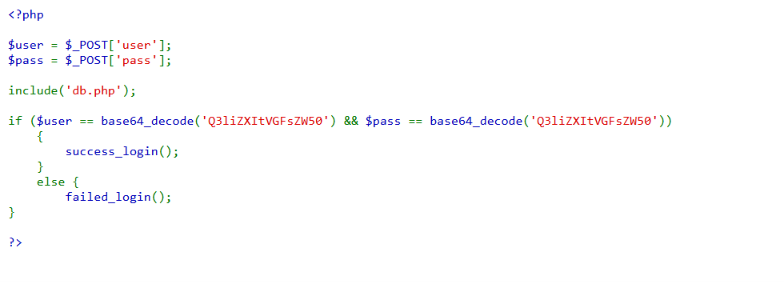

Easy message
We have the usual login page , We inspect the item nothing special same with burpsuite and nothing with sql too
Ahhh let's try to see other directories with dirb 
We find the directories /robots.txt and we get a /?source directorie
And we get a code 
 wich seems to be very unsecured wich checks if the $user=something in base64
and $pass= something in base64 the user is Cyber-Talent and the pass is the same
let's try logging in with those creds and the message seems to be a morse code encrypted 
nothing big let's use a online decryptor and here is the flag
FLAG(I-KN0W-Y0U-AR3-M0RS3)