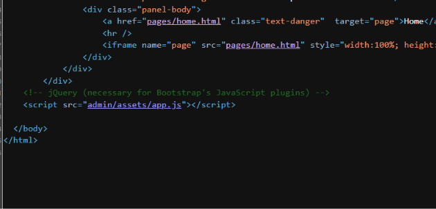
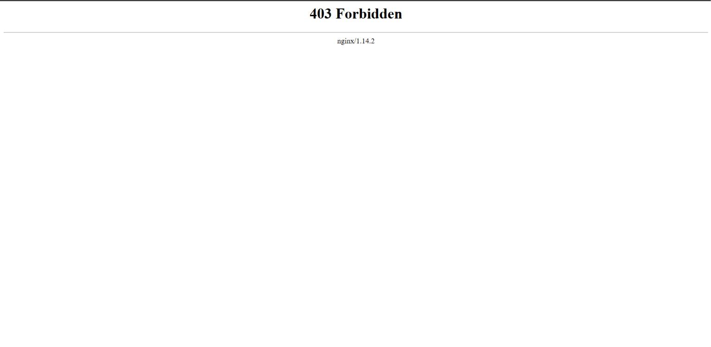
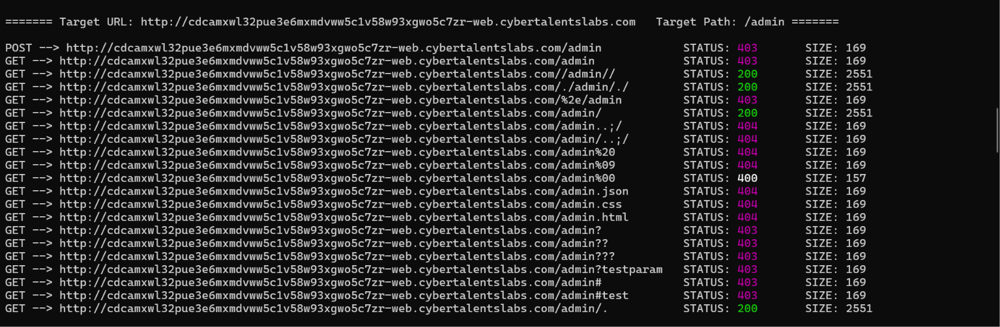
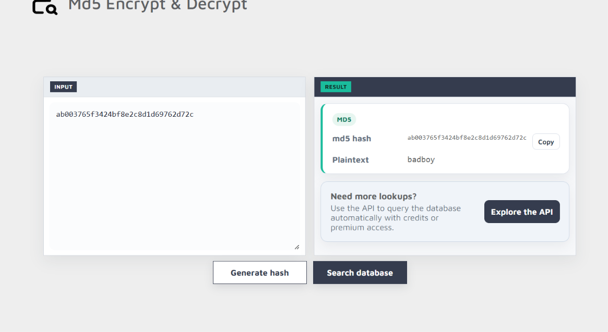

Encrypted Database
We land on the main page wich appears to be a blog 
nothing intresting beside the blog appears to be in latin
I'll see the source of this page

we find "admin/assets/app.js" if  we try to open it

But we get a 403 forbidden :/
let's try to bypass it using a tool i like 
"https://github.com/yunemse48/403bypasser"
we git clone it and install the requirements
We find an admin directory now the right ones (the ones with 200)

we read the source and then we see "secret-database/db.json"
we get in and there is the flag 
we put it in but no it's wrong we'll if we see the name of the challenge it's called encrypted 
sooo it seems to be hash  first we use a hash analyser online to get it type
it seems to be md5 or md4 let's use a md5 decryptor online 

And that's the flag huraaay 

