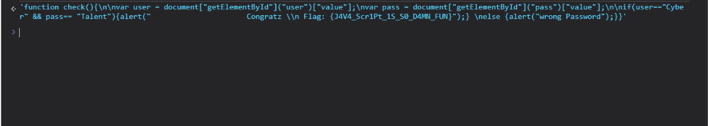

Iam legend 
So we see the usual login page so we look in the view-source and we find what it's called jsfuck 
We can decode it in two ways :
	Using an online decoder
	Or just uing the console: with check.tostring()
	
and voila we got itt