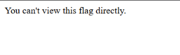
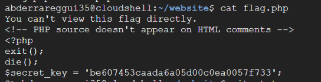

Maximum Courage
First we get nothing but just a challenge to see the flag we try hopping in but it doesn't show us 
 
nothing intresting in the source nor in burp let's discover other directories using dirb 
we find a .git directorie let's use git-dump it and we find the flag.php and we cat and there we are 
 

