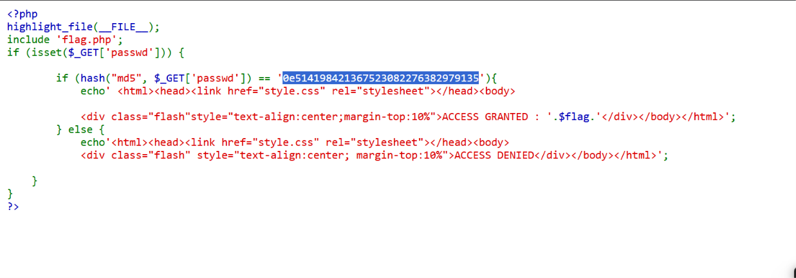
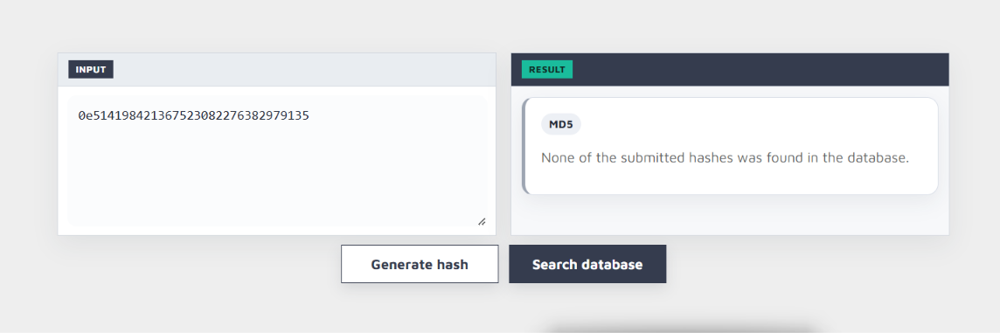
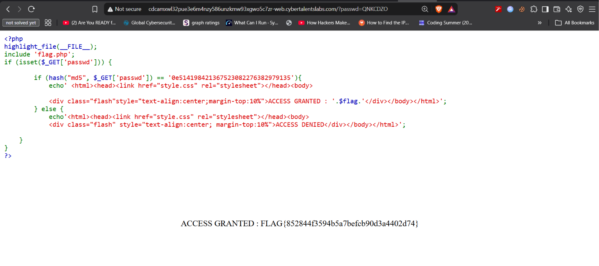

T-Jungle
We have a page with a source-code of a php page 
 
 It may look hard to understand but it just checks in the url if the dir after ?passwd== the hash in md5
 let's check an online md5 hash decryptor 
  
nothing let's use hash cat and rockyou.txt
It took a little but finally find it "QNKCDZO"
let's try it now 
  
there is the flag "FLAG{852844f3594b5a7befcb90d3a4402d74}"