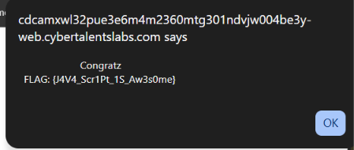

So we start the challenge by seeing view-source with ctrl-u 
and we will find a hexcoded code 

so we decode it and get 

and we extract the variable using console.log(_0xae5b) and get 

then  _0xeb80x2=document[_0xae5b[2]](_0xae5b[1])[_0xae5b[0]];
then we conclude that _0xeb80x2 is the username 
and we see and if function and check if _0xeb80x2 == _0xae5b[4] && _0xeb80x3 == _0xae5b[4])
then we know username=the 4th array of _0xae5b wich is "Cyber-Talent" and the _0xeb80x3 is "Cyber-Talent"
soo we try that and we get the flag

