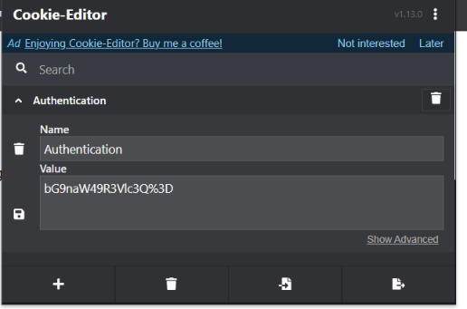
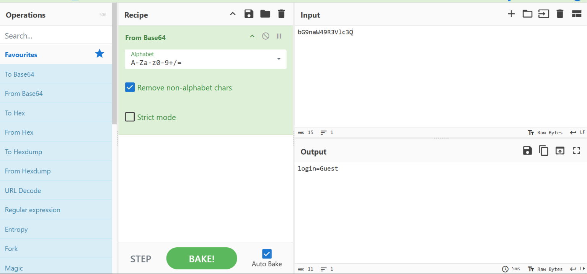

who am i?
We land on a login page We inspect it as usual We find there's a guest account credentials 
We login but we still are guests and have adminstrative previliges 
nothing else really stands out If we tried inspecting the cookies using an extension i really like Cookie editor
we find 

We can put it into cyberchef wich is a very cool website it appears to be base64
we decode it and get that the website saves our role in cookies

let's try reverse that and put "login=admin" to base64 and put it in cookies
"bG9naW49YWRtaW4=%3D"
and we get the flag 
